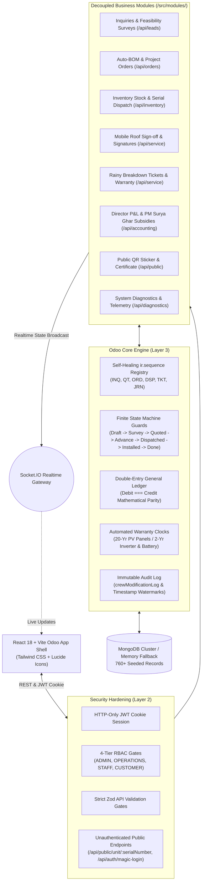
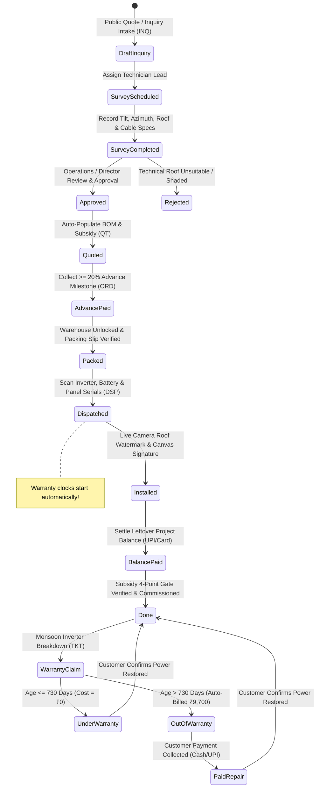
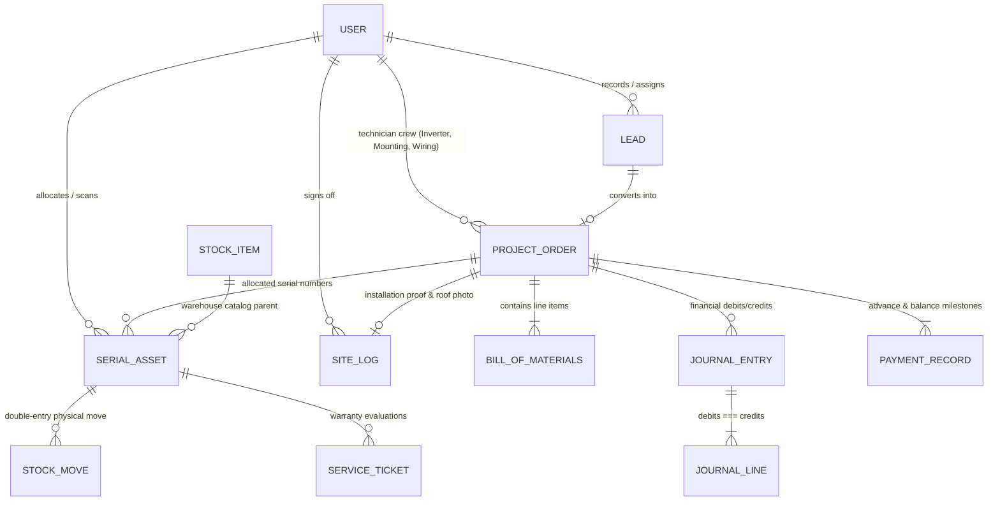

# ☀️ SolIMS — Solar Installation Management System ERP
### *The Digital Operational Backbone for Solar EPC & Asset Lifecycle Management*


[](https://github.com/aspirant-22/SolIMS_Odoo_Hack)
[-135D3B?style=for-the-badge)](https://github.com/aspirant-22)
[](#)
[](#)
[](LICENSE)

**Event:** ☀️ **Odoo x LPU Jalandhar Hackathon 2026 — Built Solo by Garima Mittal**  
**Author:** Garima Mittal  
**Architecture:** Decoupled Odoo 'Apps' Architecture (MongoDB, Express, React 18 + Vite, Node.js, Tailwind CSS, Lucide Icons, Socket.IO)

---

## 🌟 Executive Summary
**SolIMS Solutions** executes ~40 rooftop solar projects each month for residential homes and industrial commercial clients. The business operates across the entire solar engineering lifecycle: running on-site technical roof surveys, generating certified Bill-of-Materials (BOM) quotations, managing warehouse inventory of high-value serialized hardware (Tier-1 DCR solar panels, smart grid-tie inverters, lithium battery packs, charge controllers, safety earthing kits), deploying a field crew of 15 certified technicians, and managing 20-year post-commissioning warranty coverage.

Before SolIMS, inquiries were lost in unstructured messaging threads, quotes omitted critical small mounting accessories, serial numbers were misplaced from paper delivery notebooks, and rainy-season inverter failures lacked verifiable installation records. **SolIMS** solves every one of these real operational bottlenecks through an integrated Odoo-grade ERP system engineered to automate physical and financial workflows with zero-leakage business guardrails.

---

## 🎬 Project Demo Video

> 📺 **Watch the complete architectural & workflow walkthrough of SolIMS:**

[](https://youtu.be/35sMNZJ4iSI)

---

## 🏆 Problem Statement ➔ SolIMS Feature Solution Mapping

| Target Hackathon Scene | Real Operational Headache | SolIMS Engineered Solution |
| :--- | :--- | :--- |
| **Scene 1: Progressive Onboarding & Inquiries** | Inquiries lost in WhatsApp chats; quotes typed before inspecting roof feasibility; users forced into complex registration. | **Progressive Customer Onboarding**: Zero-login public quote calculator (`/quote`), restricted pre-survey tracking (`/track`), and post-survey cryptographic activation (`/activate-account?token=...`) via an in-app **Zero-Config Simulated Mailbox**. |
| **Scene 2: Strict Feasibility & Advance Guardrails** | Staff quote unfeasible roofs; warehouse packs items without advance payment; quotes cannot be modified. | **Strict FSM Approval Gates**: Roof survey measurements role-gated to `STAFF` only, technical approval gated to `ADMIN`/`OPERATIONS`. Dynamic re-clickable Auto-BOM (1 kW–5 kW On/Off-Grid), strict **$\ge$ 20% minimum advance validation**, and dedicated **Leftover Balance Payment** gateway with online payment capture (`UPI / NetBanking / Card`). |
| **Scene 3: Specialized Crews & Warehouse Dispatch** | High-value hardware dispatched with missing parts; uncoordinated crews; lost serial logs. | **3-Specialist Crew Assignment**: Dedicated dropdowns for Inverter Specialist, Rooftop Mounting Technician, and High-Voltage Wiring Technician with an **immutable audit log**. Warehouse stock-verified Packing Slip, barcode serial scanner, and **automated 2-year (inverter/battery) & 20-year (panel) warranty clocks**. |
| **Scene 4: Mobile Live Camera Roof Sign-off** | Paper site registers, fake job confirmations, photos scattered across private chat groups. | **Mobile Roof Sign-off**: Live `getUserMedia` camera feed with timestamped location watermark burning, HTML5 customer signature canvas, printable **Handover & Warranty Certificate (`/certificate/:orderId`)**, and public mobile **QR Inverter Sticker Lookup (`/u/:serialNumber`)**. |
| **Scene 5: Monsoon Breakdown & Subsidy Readiness** | Inverter trips in heavy rain 18 months later; support disputes coverage; PM Surya Ghar subsidy audit fails. | **Automated Warranty Engine**: Instant lookup via QR sticker or serial. 18-month inverter costs **₹0**; 26-month inverter auto-bills **₹9,700** BOM rate with customer sign-off and payment gate. **4-Point PM Surya Ghar Subsidy Readiness Checklist** gates subsidy disbursement. |
| **Scene 6: Director Month-End P&L & Telemetry** | Director lacks visibility into unit economics, technician payroll, or system health across time horizons. | **Executive Director Dashboard**: Dynamic period filtering (`Today / This Week / This Month`), equipment COGS vs crew wages vs warranty costs, strict **Double-Entry General Ledger (`Debits === Credits`)**, 1-click CSV export, `Ctrl + K` Command Palette, and live telemetry (`/admin/system-logs`). |

---

## ⚡ Core Feature Deep Dive & Technical Architecture

### 1. Progressive Customer Onboarding & Simulated Mailbox
- **Zero-Login Public Inquiries (`/quote`)**: Homeowners calculate estimated system capacity from monthly power bills and roof area, submitting inquiries with auto-allocated sequential numbering (`INQ/2026/XXXX`).
- **Restricted Pre-Survey Tracking (`/track`)**: Pre-survey customers can track their inquiry status securely without exposing internal ERP modules.
- **Cryptographic Account Activation (`/activate-account?token=...`)**: Once the feasibility survey is approved, a secure zero-config magic link is dispatched.
- **In-App Simulated Customer Mailbox**: A dedicated zero-dependency simulated mailbox renders on public views (`/`, `/quote`, `/login`) and within the authenticated top navbar, enabling judges to view activation emails and one-click magic login tokens without third-party email dependencies.

### 2. Strict Technical Feasibility & Advance Payment Guardrails
- **Role-Gated Survey Approval**: Technicians (`STAFF`) record azimuth direction (South, South-West, etc.), tilt angle (e.g., 22°), shadow-free area (sq ft), and cable run distance (meters). Quotation generation is **strictly blocked** until an `ADMIN` or `OPERATIONS` manager reviews and approves the feasibility report.
- **Re-Clickable Auto-BOM Engine**: Instant calculation of complete Bill-of-Materials for 1 kW to 5 kW systems in both On-Grid and Off-Grid configurations, factoring in MNRE PM Surya Ghar subsidy discounts.
- **Minimum 20% Advance Milestone Gate**: Quotations cannot transition to project orders without collecting $\ge 20\%$ of the net project cost, allocating sequential `ORD/2026/XXXX` and generating balanced double-entry accounting records.
- **Leftover Balance Payment Stage**: Explicit milestone gate supporting final balance settlement with multi-mode payment capture (`UPI`, `NetBanking`, `Card`) and transaction reference verification.

### 3. Specialized 3-Technician Crew Assignment & Immutable Audit Trail
- **Dedicated Specialist Assignment**: Assigns three specialized technician roles to every confirmed project:
  - ⚡ **Inverter Specialist** (grid synchronisation & DC-to-AC commissioning)
  - 🛠️ **Rooftop Mounting Technician** (structural ballast & rail anchoring)
  - 🔌 **High-Voltage Wiring Technician** (conduit cabling, earthing electrodes & lightning arrestors)
- **Immutable Modification Log (`crewModificationLog`)**: Append-only audit trail logging timestamp, author ID, role change reason, and exact before-and-after technician assignments.

### 4. Warehouse Stock Management, Packing Slip & Automated Warranty Clocks
- **Live Inventory Stock View (`/inventory`)**: Real-time visibility into warehouse stock levels, minimum reorder thresholds, reserved quantities, and restock triggers.
- **Stock-Verified Dispatch Packing Slip**: Compares bill of materials against current on-hand warehouse inventory before releasing equipment.
- **Barcode Serial Scanning**: Validates serial numbers for smart inverters, lithium batteries, charge controllers, and solar panels against the specific project order.
- **Automated Warranty Clock Initiation**: Confirming dispatch automatically starts the official warranty clocks:
  - **Grid-Tie Inverter / Lithium Battery**: **2 Years (730 Days)**
  - **Tier-1 Solar PV Panels**: **20 Years (7,300 Days)**

### 5. Mobile Live Camera Sign-Off, Printable Certificates & Public QR Stickers
- **Live Camera Capture with Timestamp Watermark**: Technicians capture finished rooftop installations using live device cameras (`navigator.mediaDevices.getUserMedia`) with burned-in timestamps and GPS coordinates.
- **HTML5 Digital Signature Canvas**: Homeowner signs directly on the technician's mobile tablet screen to formally accept the commissioned installation.
- **Printable Handover & Warranty Certificate (`/certificate/:orderId`)**: Print-ready (`window.print()`) certificate displaying customer details, kW capacity, all assigned serial numbers with exact expiration dates, roof photo proof, and digital signature stamp.
- **Public QR Inverter Lookup (`/u/:serialNumber`)**: Public, mobile-friendly landing page accessible via QR code scan on physical inverter stickers. Displays real-time warranty status (`✅ ACTIVE WARRANTY — 183 Days Remaining` vs `⚠️ WARRANTY EXPIRED`) and provides a 1-click service ticket submission button.

### 6. Rainy-Season Breakdown Ticketing & PM Surya Ghar Subsidy Gate
- **Automated Warranty Engine Billing**:
  - **18-Month Old Inverter** (`INV-2024-RAINY-ACTIVE`): Identified as active OEM warranty $\rightarrow$ replacement board and labor billed at **₹0**.
  - **26-Month Old Inverter** (`INV-2024-RAINY-EXPIRED`): Identified as out-of-warranty $\rightarrow$ auto-bills standard BOM rate of **₹9,700** (₹8,500 replacement board + ₹1,200 visit fee).
- **Payment & Resolution Gates**: Out-of-warranty tickets cannot be marked as resolved until customer payment is recorded and the homeowner confirms power generation is restored.
- **4-Point PM Surya Ghar Subsidy Readiness Gate**: Enforces a strict compliance checklist before subsidy claims can be submitted:
  1. `DCR Panel Verified` (Make in India ALMM list compliant)
  2. `Serials Linked` (PV Modules & Grid-Tie Inverters bound)
  3. `Roof Photo Proof` (Post-commissioning installation photo captured)
  4. `Homeowner Signed` (Digital acceptance on handover completed)

### 7. Director Month-End P&L, Double-Entry Ledger & 760+ Record Scale
- **Dynamic Period-Filtered P&L (`Today / This Week / This Month`)**: Executive analytics calculating Gross Revenue, Hardware COGS, 15-Technician Field Payroll, Warranty Claims, and Net Operating Margin.
- **Double-Entry General Ledger**: Every financial transaction (advance payment, balance settlement, out-of-warranty service fee) generates balanced journal entries enforcing $\text{Total Debits} \equiv \text{Total Credits}$.
- **1-Click CSV Export**: Exports comprehensive financial summaries directly to formatted spreadsheets (`.csv`).
- **Global Command Palette (`Ctrl + K`)**: Instant keyboard navigation across all modules, orders, and inquiries.
- **Live System Telemetry (`/admin/system-logs`)**: Real-time server health metrics, database connection status, memory consumption, socket connections, and audit trails.

---

## 🏛️ System Architecture Diagram



---

## 🔄 Complete Finite State Machine (FSM) Lifecycle



---

## 🗄️ Entity-Relationship Diagram (ERD)



---

## 👥 Demo Personas & 1-Click Credentials

For live evaluation during the hackathon finale, `LoginView.jsx` features **1-Click Demo Persona Switcher buttons** directly on the card so judges can instantaneously switch roles without typing credentials:

| Persona Title | Role Code | Seeded Email | Password | Hackathon Demo Focus |
| :--- | :--- | :--- | :--- | :--- |
| 👑 **Managing Director** | `ADMIN` | `admin@solims.com` | `admin123` | Month-End P&L, project margins, PM Surya Ghar subsidy tracking, 1-Click CSV export, monospace diagnostics. |
| 📦 **Operations Manager** | `OPERATIONS` | `ops@solims.com` | `ops123` | Survey approval gates, auto-BOM quote generation, warehouse serial scanning, and truck dispatch. |
| ⚡ **Field Technician Lead**| `STAFF` | `tech@solims.com` | `tech123` | Roof measurement survey logs, tablet roof sign-off, wattage verification, and digital canvas signature. |
| 🏠 **Homeowner Client** | `CUSTOMER` | `customer@solims.com` | `customer123` | Real-time project status, solar warranty verification card, rainy season breakdown ticket filing. |

---

## ⚡ Judge Edge Case Verification Scenarios

### 1. Scene 1 & 2: Guardrail Blocking Quotes Until Survey Approval
- Navigate to **Inquiries & Proposals**.
- Select an inquiry in status `Draft` or `Survey_Completed`.
- Observe that generating a commercial quote is **strictly disabled and blocked** until operations approves the technical survey.
- Approve the survey ➔ click **Auto-Generate BOM Quote** ➔ witness instant BOM calculation with government subsidy discount.
- Test advance payment: attempts below 20% are blocked by business validation.

### 2. Scene 3: Warehouse Stock, Serial Scanning & Automated Warranty
- Navigate to **Inventory Stock** (`/inventory`) to inspect live stock on hand.
- Navigate to **Warehouse & Serials** (`/dispatch`) and select a ready order.
- Verify that items cannot be dispatched without serial allocation.
- Use the **Quick Scan Buttons** to scan Inverter and Battery serials.
- Click **Confirm Dispatch & Start Warranty Clocks** ➔ witness immediate creation of double-entry stock movement records and auto-calculated warranty expirations:
  - Solar Panels: **20 Years (7,300 days)**
  - Inverter / Battery: **2 Years (730 days)**

### 3. Scene 4: Field Roof Sign-off with Live Camera & Canvas Signature
- Navigate to **Roof Sign-off Mobile** (`/field-install`).
- Inspect test power generation (e.g., 2,850 W), start and finish times.
- Capture a live camera photo (watermarked with timestamp and GPS).
- Draw customer signature on the interactive **HTML5 Signature Canvas**.
- Click **Accept Work & Submit Final Sign-off** ➔ order transitions to `Installed` and locks proof.
- Navigate to `/certificate/:orderId` to inspect the print-ready official Handover Certificate.

### 4. Scene 5: Rainy Season Inverter Breakdown (₹0 vs ₹9,700 Billable)
- Open mobile landing page `/u/INV-2024-RAINY-ACTIVE` (or navigate to **Rainy Warranty & Tickets**):
  - Serial: `INV-2024-RAINY-ACTIVE` (18-Month Old Inverter during Heavy Rain)
  - Live Status: **✅ ACTIVE WARRANTY — 183 Days Remaining**
  - Customer Bill: **₹0** (Parts = ₹0, Labor = ₹0).
- Open mobile landing page `/u/INV-2024-RAINY-EXPIRED`:
  - Serial: `INV-2024-RAINY-EXPIRED` (26-Month Old Inverter Out-of-Warranty)
  - Live Status: **⚠️ WARRANTY EXPIRED**
  - Customer Bill: **₹9,700** (Auto-billed: Replacement Board ₹8,500 + Visit Fee ₹1,200).
- Observe that out-of-warranty tickets cannot be marked as resolved until payment is collected.

### 5. Scene 6: Director Month-End P&L, PM Surya Ghar Gate & CSV Export
- Navigate to **Director P&L & Subsidies** (`/director`).
- Toggle between **Today**, **This Week**, and **This Month** ➔ observe dynamic recalculation of revenue, COGS, and payroll.
- Test the **PM Surya Ghar Subsidy Readiness Gate**: verifies 4-point compliance checklist (`DCR Panel Verified`, `Serials Linked`, `Roof Photo Proof`, `Homeowner Signed`) before approving subsidy submission.
- Click **1-Click CSV Export** to download `SolIMS_Director_Executive_PnL_MONTH_2026.csv`.
- Inspect the **Double-Entry General Ledger** tab to verify strict mathematical debit/credit parity.

---

## 🚀 Quickstart & Setup Instructions

### 1. Prerequisites
- **Node.js**: v18+ (tested on Node v20.x & v22.x)
- **npm**: v9+
- **MongoDB**: Local MongoDB instance (`mongodb://127.0.0.1:27017/solims`) OR automatic in-memory fallback.

### 2. Installation
```bash
# Clone the repository
git clone https://github.com/aspirant-22/SolIMS_Odoo_Hack.git
cd SolIMS

# Install dependencies for both server and client
npm --prefix server install
npm --prefix client install
```

### 3. Automated Business Guardrail Verification Suite
SolIMS includes a zero-dependency, automated unit test suite verifying core business rules:
```bash
npm --prefix server test
```
**Test Suite Coverage (5/5 Passing):**
- ✔ **Rule 1**: Quotation blocked prior to feasibility survey approval.
- ✔ **Rule 2**: Minimum 20% advance payment milestone required.
- ✔ **Rule 3**: Warranty clock auto-calculates correct validity dates (2-yr inverter/battery, 20-yr panels).
- ✔ **Rule 4**: Ticket billing calculates ₹0 (under warranty) vs ₹9,700 standard BOM rate (expired).
- ✔ **Rule 5**: Double-entry ledger balance strictly enforces $\text{Total Debits} \equiv \text{Total Credits}$.

### 4. Database Seeding (760+ Realistic Historical Records)
The database seeder populates **760+ comprehensive enterprise records** distributed realistically across the past 30 days:
```bash
# Seed 760+ records across 8 collections with synchronized sequence counters:
npm --prefix server run seed
```
**Seeded Document Breakdown (760 Documents):**
- 👤 **18 Users** (Managing Director, Operations Managers, 15 Certified Technicians, Customer)
- ⚡ **150 Serial Assets** (Tracked inverters, batteries, charge controllers, solar PV panels)
- 📦 **12 Warehouse Stock Catalog Items** (Tier-1 modules, mounting hardware, balance of system)
- 📋 **170 Inquiry Leads** (Spanning all feasibility and approval stages)
- 🏗️ **140 Project Orders** (Draft, Advance Paid, Balance Due, Dispatched, Installed, Done)
- 📸 **60 Site Execution Logs** (With test power wattage, time logs, and photos)
- 🔧 **50 Breakdown Service Tickets** (Under warranty and out-of-warranty breakdown cases)
- 📒 **160 Balanced General Ledger Entries** (Double-entry accounting records with strict parity)

### 5. Running the Development Servers
```bash
# Terminal 1: Run Express API Server (Port 5000)
npm --prefix server run dev

# Terminal 2: Run Vite React Frontend (Port 5173)
npm --prefix client run dev
```
Open [http://localhost:5173](http://localhost:5173) in your browser.

---

## 🔒 Security Hardening & Production Reliability
- **HTTP-Only JWT Cookies**: Mitigates Cross-Site Scripting (XSS) session theft.
- **Strict Zod Boundary Gates**: Every incoming HTTP body is parsed and validated before reaching service logic.
- **Role-Based Access Control (RBAC)**: Strict permission boundaries for `ADMIN`, `OPERATIONS`, `STAFF`, and `CUSTOMER`.
- **Global `isSystemProcessing` Overlay**: Shields against double-click race conditions on financial mutations.
- **Graceful Network Latency Banner**: Triggers strictly on genuine 15-second network aborts (`ECONNABORTED`).
- **Resilient MongoDB Fallback**: Connects to `mongodb://127.0.0.1:27017/solims` with automatic `MongoMemoryServer` bootstrapping in development environments.

---

*☀️ Built with precision for the **Odoo x LPU Jalandhar Hackathon 2026** by **Garima Mittal**.*
