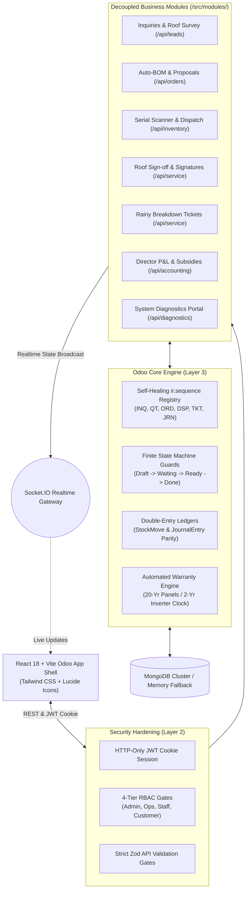
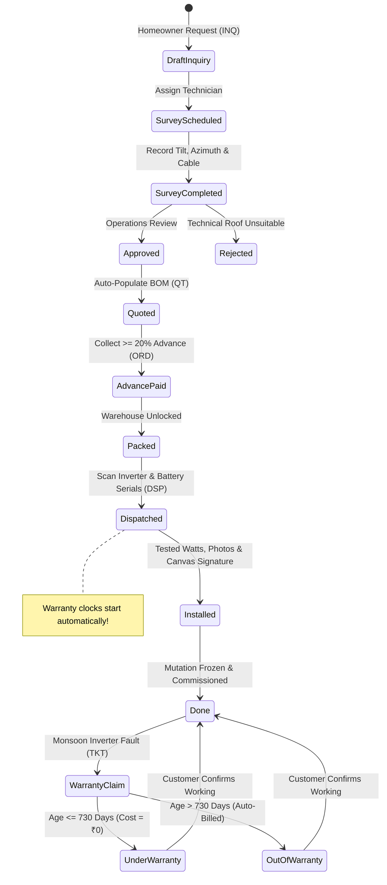
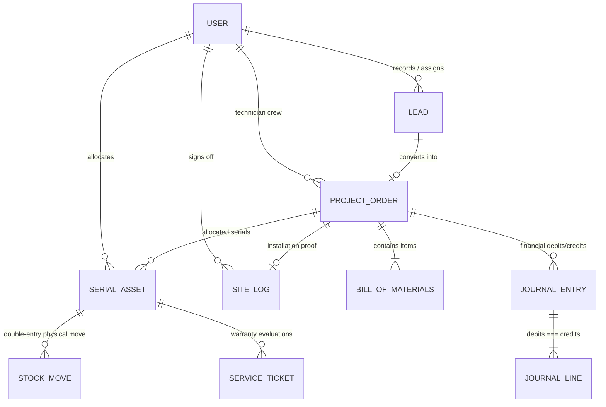

# ☀️ SolIMS — Solar Installation Management System ERP
### *The Digital Operational Backbone for Solar EPC & Asset Lifecycle Management*
**Author:** Garima Mittal  
**Event:** Odoo Hackathon Finale  
**Architecture:** Decoupled Odoo 'Apps' Architecture (MongoDB, Express, React + Vite, Node.js, Tailwind CSS, Lucide Icons)

---

## 🌟 Executive Summary
**SolIMS Solutions** executes ~40 rooftop solar projects each month for residential homes and industrial commercial clients, runs on-site technical roof surveys, inventories high-value serialized hardware (panels, smart inverters, lithium batteries, charge controllers, safety earthing kits), and deploys a field crew of 15 certified technicians.

Before SolIMS, inquiries were lost in WhatsApp threads, quotes missed critical small components, serial numbers vanished from paper notebooks, and rainy season warranty claims lacked verifiable installation dates. **SolIMS** solves every one of these real operational bottlenecks through an integrated Odoo-grade ERP system.

---

## 🏆 Problem Statement ➔ SolIMS Feature Solution Mapping

| Target Hackathon Scene | Real Operational Headache | SolIMS Engineered Solution |
| :--- | :--- | :--- |
| **Scene 1: The Rooftop Inquiry** | Homeowner inquiries arrive on WhatsApp and calls, get lost, or are quoted before knowing if the roof gets sun. | Inquiries auto-allocate corporate `INQ/2026/0001` sequences. Enforces a **strict FSM approval gate**: Quotations are blocked until a technician logs roof direction, tilt angle (e.g. 22°), and cable distance. |
| **Scene 2: Getting the Kit Right** | Quotes typed by hand with parts forgotten; warehouse has no packing notice; crew not notified. | Ready template auto-populates exact **Bill of Materials** for 1 kW to 5 kW On-Grid and Off-Grid systems. Collecting advance (>= 20%) assigns `ORD/2026/0001`, records double-entry ledger entries, and auto-notifies the warehouse and installation crew. |
| **Scene 3: Dispatch Day & Serials** | ₹1,50,000 worth of inverters and batteries leave on trucks with lost serial records. | Barcode scanner verifies inverters, batteries, and panel batches against order BOM. Upon truck dispatch, **warranty clocks start automatically** (2 years for inverters/batteries, 20 years for panels) with zero manual date entry. |
| **Scene 4: On The Roof** | Work recorded in paper site registers with photos scattered on personal phones. | Mobile-optimized field app: Logs crew start/finish times, verifies power generation (Watts), uploads roof photos, and captures **homeowner digital screen signature** to formally accept the job. |
| **Scene 5: Rainy Season Breakdown** | 18 months later in heavy rain, inverter trips; support scrambles to check warranty; manual billing disputes. | Instant multi-parameter lookup by serial or phone. **Automated warranty engine**: If active, repairs cost **₹0**; if expired, replacement parts and ₹1,200 labor are billed automatically. Tracked until customer confirms working. |
| **Scene 6: The Director's Month-End** | Director doesn't know which jobs made or lost money, technician hours, or pending subsidy files. | **Executive Director Dashboard**: Real-time P&L per installation, equipment COGS vs crew wages vs warranty costs, PM Surya Ghar subsidy tracking pipeline, open repairs, and **1-Click CSV Export**. |

---

## 🏛️ System Architecture Diagram



---

## 🔄 Finite State Machine (FSM) Lifecycle Diagram



---

## 🗄️ Entity-Relationship Diagram (ERD)



---

## 👥 Demo Personas & 1-Click Credentials

For live evaluation during the hackathon finale, `LoginView.jsx` features **1-Click Demo Persona Switcher buttons** directly on the card so judges can instantaneously switch roles without typing credentials:

| Persona Title | Role Code | Seeded Email | Password | Hackathon Demo Focus |
| :--- | :--- | :--- | :--- | :--- |
| 👑 **Managing Director** | `ADMIN` | `admin@solims.com` | `admin123` | Month-End P&L, project margins, PM Surya Ghar subsidy tracking, 1-Click CSV export, monospace diagnostics. |
| 📦 **Operations Manager** | `OPERATIONS` | `ops@solims.com` | `ops123` | Survey approval gates, auto-BOM quote generation, warehouse serial scanning, and truck dispatch. |
| ⚡ **Field Technician Lead**| `STAFF` | `tech@solims.com` | `tech123` | Roof measurement survey logs, tablet roof sign-off, wattage verification, and digital canvas signature. |
| 🏠 **Homeowner Client** | `CUSTOMER` | `customer@solims.com` | `customer123` | Real-time project status, solar warranty verification card, rainy season breakdown ticket filing. |

---

## ⚡ 1-Click Judge Edge Case Verification Scenarios

### 1. Scene 1 & 2: Guardrail Blocking Quotes Until Survey Approval
- Navigate to **Inquiries & Proposals**.
- Select an inquiry in status `Draft` or `Survey_Completed`.
- Observe that generating a commercial quote is **strictly disabled and blocked** until operations approves the technical survey.
- Approve the survey ➔ click **Auto-Generate BOM Quote** ➔ witness instant BOM calculation with government subsidy discount.

### 2. Scene 3: Warehouse Serial Scanning & Automated Warranty
- Navigate to **Warehouse & Serials**.
- Click any ready order (e.g. `ORD/2026/0002`).
- Use the **Quick Scan Buttons** to scan the Inverter and Battery serials.
- Click **Confirm Dispatch & Start Warranty Clocks** ➔ witness immediate creation of double-entry stock movement records and auto-calculated warranty expirations:
  - Solar Panels: **20 Years (7,300 days)**
  - Inverter / Battery: **2 Years (730 days)**

### 3. Scene 4: Field Roof Sign-off with Canvas Signature
- Navigate to **Roof Sign-off Mobile**.
- Inspect test power generation (e.g. 2,850 W), start and finish times.
- Draw customer signature on the interactive **HTML5 Signature Canvas**.
- Click **Accept Work & Submit Final Sign-off** ➔ order transitions to `Installed` and locks proof.

### 4. Scene 5: Rainy Season Inverter Breakdown (₹0 vs Billable)
- Navigate to **Rainy Warranty & Tickets**.
- Click **Scenario A (18-Month Old Inverter during Heavy Rain)**:
  - Serial: `INV-2024-RAINY-ACTIVE`
  - Live Status: **UNDER WARRANTY (183 Days Left)**
  - Customer Bill: **₹0** (Parts = ₹0, Labor = ₹0).
- Click **Scenario B (26-Month Old Inverter Out-of-Warranty)**:
  - Serial: `INV-2024-RAINY-EXPIRED`
  - Live Status: **WARRANTY EXPIRED**
  - Customer Bill: **₹9,700** (Auto-billed: Replacement Board ₹8,500 + Visit Fee ₹1,200).

### 5. Scene 6: Director Month-End P&L & 1-Click CSV Export
- Navigate to **Director P&L & Subsidies**.
- Toggle between **Today**, **This Week**, and **This Month**.
- Inspect Net Profit, Hardware COGS, 15-Technician Field Payroll, and PM Surya Ghar subsidy tracking.
- Click **1-Click CSV Export** to download `SolIMS_Director_Executive_PnL_MONTH_2026.csv`.
- Inspect the **Double-Entry General Ledger** tab to verify strict mathematical debit/credit parity.

---

## 🚀 Quickstart & Setup Instructions

### 1. Prerequisites
- Node.js v18+ (tested on Node v22.17.0)
- npm v9+

### 2. Installation
```bash
# Clone the repository
git clone https://github.com/aspirant-22/SolIMS_Odoo_Hack.git
cd SolIMS

# Install dependencies for both server and client
npm --prefix server install
npm --prefix client install
```

### 3. Database Seeding (170+ Realistic Historical Records)
```bash
# Seeds 18 users (including 15 technicians), 62 hardware serial assets,
# 30 leads, 20 orders, 15 tickets, 15 balanced journals, and syncs ir.sequence counters:
npm run seed
```

### 4. Running the Development Servers
```bash
# Terminal 1: Run Express API Server (Port 5000)
npm run server

# Terminal 2: Run Vite React Frontend (Port 5173)
npm run client
```
Open [http://localhost:5173](http://localhost:5173) in your browser.

---

## 🔒 Security Hardening & Production Reliability
- **HTTP-Only JWT Cookies**: Mitigates Cross-Site Scripting (XSS) session theft.
- **Strict Zod Boundary Gates**: Every incoming HTTP body is parsed and validated before reaching service logic.
- **Global `isSystemProcessing` Overlay**: Shields against double-click race conditions on financial mutations.
- **Graceful Network Latency Banner**: Triggers strictly on genuine 15-second network aborts (`ECONNABORTED`).
- **Resilient MongoDB Fallback**: Connects to `mongodb://127.0.0.1:27017/solims` with automatic `MongoMemoryServer` bootstrapping in development environments.

---
*Built with precision for the Odoo Hackathon Finale by Garima Mittal.*
